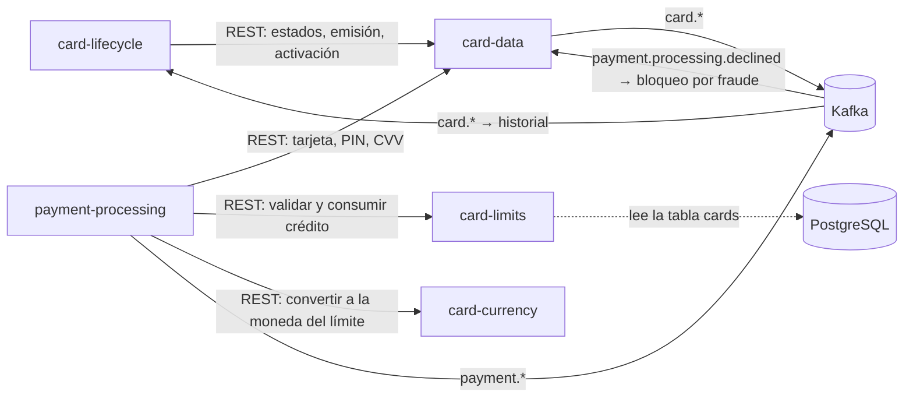

# Card Management Service

Backend de gestión de tarjetas de crédito: alta y ciclo de vida de la tarjeta, límites de crédito y procesamiento de pagos. Es un monorepo Maven (Java 17, Spring Boot 3.3.5) con microservicios en arquitectura hexagonal que se comunican por REST y Kafka.

> **Entorno de desarrollo.** La API no tiene autenticación y el PAN, el CVV y el PIN viajan en claro entre servicios (salvo el PIN block de los adelantos). Las limitaciones de cada módulo están al final de su documento técnico.

## Contenido

- [Módulos](#módulos)
- [Cómo se integran](#cómo-se-integran)
- [Levantar el stack](#levantar-el-stack)
- [Build y tests](#build-y-tests)
- [Probar la API](#probar-la-api)
- [Documentación](#documentación)

## Módulos

| Módulo | Tipo | Puerto | Responsabilidad | Documento |
|---|---|---|---|---|
| `card-shared` | Librería | — | Value Objects (`CardNumber`, `CVV`, `PIN`, `Money`, `CardStatus`…), excepciones, cifrado y hashing | [SHARED.md](docs/technical/SHARED.md) |
| `card-events` | Librería | — | Contrato de eventos de dominio y nombres de topics de Kafka | [EVENTS.md](docs/technical/EVENTS.md) |
| `card-data` | Servicio | 8081 | Aggregate `Card`: alta, datos del titular, datos sensibles, estados, bloqueo, PIN y CVV | [DATA.md](docs/technical/DATA.md) |
| `card-limits` | Servicio | 8082 | Aggregate `CreditLimit`: límites, consumo y liberación de crédito, validación de compras | [LIMITS.md](docs/technical/LIMITS.md) |
| `card-lifecycle` | Servicio | 8083 | Orquesta las transiciones de estado con una state machine y guarda el historial | [LIFECYCLE.md](docs/technical/LIFECYCLE.md) |
| `payment-processing` | Servicio | 8085 | Aggregate `Transaction`: compras, adelantos, preautorización, reversos, devoluciones y liquidación | [PAYMENT.md](docs/technical/PAYMENT.md) |
| `card-currency` | Servicio | 8086 | Monedas aceptadas, cotizaciones por par con vigencia y conversión de montos | [README](services/card-currency/README.md) |

El código de cada módulo está en `services/<módulo>`.

## Cómo se integran



- **card-data** es dueño de la tarjeta. card-lifecycle valida cada transición y después llama a card-data, que publica el evento `card.*` por un outbox transaccional.
- **card-lifecycle** arma el historial consumiendo esos eventos, así que depende de Kafka para mostrarlo.
- **payment-processing** valida la tarjeta en card-data y el crédito en card-limits antes de autorizar. Un rechazo por fraude publica `payment.processing.declined` y card-data bloquea la tarjeta.
- **card-currency** convierte los pagos a la moneda del límite de la tarjeta: payment-processing le pide la conversión cuando el pago viene en otra moneda.
- Todos los servicios comparten la base `card_management_db`. El esquema se administra en otro repo: [card-management-database](https://github.com/creditcard-managment/card-management-database).

## Levantar el stack

Requisitos: Docker con Compose v2, y JDK 17 con Maven 3.9 si vas a compilar fuera de Docker.

1. **Base de datos y migraciones**, desde el repo `card-management-database`:
   ```bash
   docker compose up -d postgres pgadmin
   docker compose up flyway
   ```
2. **Kafka y los cinco servicios**, desde este repo:
   ```bash
   docker compose -f deploy/docker/docker-compose.yml up -d --build
   ```
   Los dos compose comparten la red `card-network`. card-lifecycle arranca recién cuando card-data está *healthy*: si card-data tarda o falla, compose no crea card-lifecycle. Revisalo con `docker compose -f deploy/docker/docker-compose.yml ps -a`.
3. **Datos de prueba para pagos.** payment-processing exige un comercio y una terminal activos, y el esquema no los trae:
   ```bash
   docker exec -i card-db-postgres psql -U postgres -d card_management_db < docs/postman/dev-seed-merchants.sql
   ```
4. **Verificar:** `curl localhost:8081/actuator/health` (y 8082, 8083, 8085, 8086).

Las claves de cifrado del compose son de desarrollo. Se sobrescriben con variables de entorno (`ENCRYPTION_KEY_K1`, `PIN_ENCRYPTION_KEY_V1`, …), ver [DATA.md](docs/technical/DATA.md).

## Build y tests

```bash
mvn clean install                         # build y tests de todos los módulos
mvn test -pl services/card-data -am       # un módulo y sus dependencias
```

Los tests de persistencia usan Testcontainers, así que necesitan Docker.

## Probar la API

- **Swagger UI:** `http://localhost:<puerto>/swagger-ui.html` en cada servicio (8081, 8082, 8083, 8085, 8086).
- **Postman:** [`docs/postman/Card Management System.postman_collection.json`](docs/postman/Card%20Management%20System.postman_collection.json). La carpeta *0. Flujo punta a punta* recorre alta, aprobación, límite, emisión, activación, pagos (incluida una compra en USD convertida con card-currency), bloqueos y cancelación con el Collection Runner. Las carpetas 1 a 5 tienen el resto de los endpoints de cada servicio. Sin Postman instalado:
  ```bash
  docker run --rm --network host -v "$PWD/docs/postman:/etc/newman" postman/newman:6-alpine \
    run "Card Management System.postman_collection.json" --folder "0. Flujo punta a punta"
  ```

## Documentación

Cada documento técnico describe el modelo de dominio, la API, los flujos, la persistencia, la configuración y las limitaciones conocidas del módulo.

- [SHARED.md](docs/technical/SHARED.md): card-shared
- [EVENTS.md](docs/technical/EVENTS.md): card-events y catálogo de topics
- [DATA.md](docs/technical/DATA.md): card-data
- [LIMITS.md](docs/technical/LIMITS.md): card-limits
- [LIFECYCLE.md](docs/technical/LIFECYCLE.md): card-lifecycle
- [PAYMENT.md](docs/technical/PAYMENT.md): payment-processing
