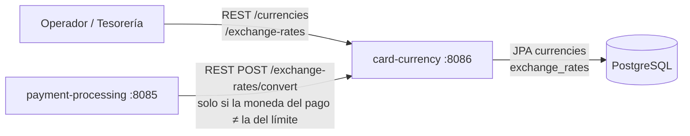
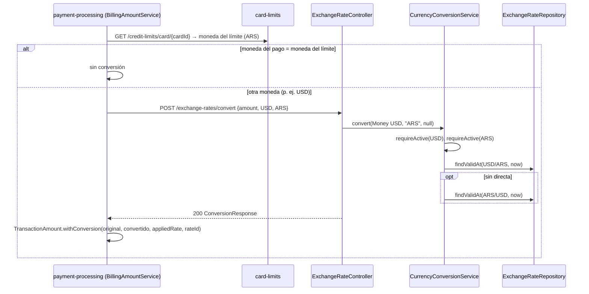
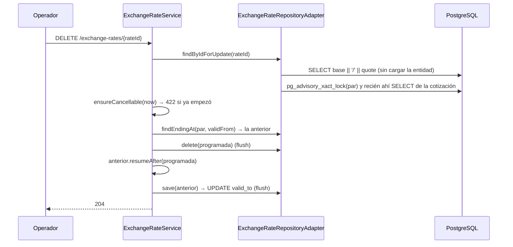

# card-currency — Documentación técnica funcional

> Microservicio dueño del **catálogo de monedas** que acepta el sistema y de sus **cotizaciones**: alta y estado de monedas ISO 4217, publicación de la cotización de cada par con su vigencia, consulta del historial y conversión de montos con la cotización vigente en un instante dado.

| Atributo | Valor |
|---|---|
| Artefacto Maven | `com.unisono.card:card-currency` (`1.0.0-SNAPSHOT`) |
| Clase principal | `com.unisono.card.currency.CardCurrencyApplication` |
| Puerto | `8086` |
| Base paths REST | `/api/v1/currencies`, `/api/v1/exchange-rates` |
| Base de datos | PostgreSQL `card_management_db` — tablas propias `currencies` y `exchange_rates` (migración V19). No lee tablas de otros módulos |
| Mensajería | Ninguna: no publica ni consume (no tiene dependencias de Kafka ni de `card-events`, §9) |
| Dependencias internas | `card-shared` (`Money`, excepciones `NotFoundException`, `ValidationException`, `InvalidValueObjectException`, `BusinessRuleException`) |
| Swagger UI | `http://localhost:8086/swagger-ui.html` (OpenAPI en `/api-docs`) |

---

## 1. Responsabilidad dentro del sistema

`card-currency` responde **cuánto vale un monto en otra moneda**. Los límites de crédito están en la moneda del sistema (ARS, ver [LIMITS.md §9.1](LIMITS.md)); cuando un pago llega en otra moneda, `payment-processing` le pide a este servicio la conversión antes de validar y consumir crédito.



- **Mantiene el catálogo** de monedas aceptadas: solo las activas se cotizan y convierten. La moneda del sistema no se puede desactivar.
- **Publica cotizaciones** por par (`1 base = rate quote`) con vigencia `[validFrom, validTo)`. Una sola cotización abierta por par: publicar una nueva cierra la anterior. Cada par se cotiza **en un solo sentido** (USD/ARS o ARS/USD, no los dos).
- **Cancela cotizaciones programadas** que todavía no empezaron; la anterior del par sigue vigente.
- **Convierte montos** con la cotización vigente en un instante (por defecto, ahora), directa o inversa.
- **Conserva el historial**: una cotización que ya empezó nunca se borra ni se modifica, solo se cierra. Esto permite saber con qué tasa se convirtió cada pago (`payment-processing` guarda el `rateId`).

> `payment-processing` usa un único endpoint:
> - **Al autorizar un pago en otra moneda:** `POST /exchange-rates/convert` con `{ amount, fromCurrency, toCurrency }`, sin `at` (cotización vigente ahora).
> - Guarda el monto convertido, `appliedRate` y `rateId` en la transacción ([PAYMENT.md §4 y §7](PAYMENT.md)).

---

## 2. Arquitectura

Hexagonal:

```
com.unisono.card.currency
├── domain
│   ├── model        SupportedCurrency, ExchangeRate, CurrencyPair (VO), Conversion (VO), RateSource
│   ├── port.input   ManageCurrenciesUseCase, ExchangeRateUseCase (+ PublishRateCommand),
│   │                ConvertAmountUseCase
│   ├── port.output  CurrencyRepository, ExchangeRateRepository
│   ├── service      CurrencyCatalogService, ExchangeRateService, CurrencyConversionService
│   └── exception    CurrencyAlreadyExistsException, CurrencyNotSupportedException,
│                    ExchangeRateNotFoundException
├── application
│   ├── dto          RegisterCurrencyRequest, PublishExchangeRateRequest, ConvertAmountRequest,
│   │                CurrencyResponse, ExchangeRateResponse, ConversionResponse
│   └── mapper       CurrencyDtoMapper
└── infrastructure
    ├── adapter.input.rest           CurrencyController, ExchangeRateController, GlobalExceptionHandler
    ├── adapter.output.persistence   CurrencyRepositoryAdapter, ExchangeRateRepositoryAdapter,
    │                                CurrencyEntity, ExchangeRateEntity,
    │                                JpaCurrencyRepository, JpaExchangeRateRepository
    └── config                       CurrencyDatabaseConfig (JPA), ClockConfig (Clock UTC), SwaggerConfig,
                                     SystemCurrencyCheck (verificación al arrancar)
```

Los servicios reciben un `java.time.Clock` (bean `Clock.systemUTC()`), así los tests fijan la hora. `ExchangeRateService` y `CurrencyConversionService` dependen de `CurrencyCatalogService` (no del puerto) para usar `requireActive(...)`.

### Mapa de casos de uso → servicios → endpoints

| Caso de uso (port input) | Implementación | Endpoints |
|---|---|---|
| `ManageCurrenciesUseCase` | `CurrencyCatalogService` | `POST /currencies`, `GET /currencies`, `GET /currencies/{code}`, `PUT /currencies/{code}/activate`, `PUT /currencies/{code}/deactivate` |
| `ExchangeRateUseCase` | `ExchangeRateService` | `POST /exchange-rates`, `DELETE /exchange-rates/{rateId}`, `GET /exchange-rates/{base}/{quote}`, `GET /exchange-rates/{base}/{quote}/history` |
| `ConvertAmountUseCase` | `CurrencyConversionService` | `POST /exchange-rates/convert` |

---

## 3. Modelo de dominio

### 3.1 `SupportedCurrency`

Moneda que el sistema acepta para operar.

| Campo | Tipo | Descripción |
|---|---|---|
| `currency` | `java.util.Currency` | Código ISO 4217 validado y normalizado a mayúsculas (`code` en la API) |
| `name` | `String` | Obligatorio, hasta 100 caracteres, se guarda sin espacios al inicio ni al final |
| `active` | `boolean` | Solo las activas se cotizan y convierten |
| `createdAt`, `updatedAt` | `Instant` | Auditoría. `updatedAt` cambia solo si el estado cambia de verdad |
| `fractionDigits` (derivado) | `int` | `Currency.getDefaultFractionDigits()`. Siempre 2 en las monedas dadas de alta por la API (ver `register`) |

| Método | Validaciones | Efecto |
|---|---|---|
| `register(code, name, now)` | Código ISO válido, nombre obligatorio ≤ 100, **moneda de 2 decimales** (`SUPPORTED_FRACTION_DIGITS`; JPY, CLP, BHD, KWD → `BusinessRuleException` 422) | Nueva moneda **activa** |
| `activate(now)` | — | Idempotente: si ya estaba activa no cambia nada |
| `deactivate(systemCurrency, now)` | No puede ser la moneda del sistema (`BusinessRuleException` → 422) | Idempotente. No toca sus cotizaciones |

Solo se aceptan monedas de 2 decimales porque `Money` redondea todo a 2 (§3.3): una moneda sin decimales o con 3 quedaría mal representada. `restore` no aplica la regla, así una moneda cargada a mano en la base se sigue pudiendo leer.

La **moneda del sistema** se configura con `card.currency.system-currency` (por defecto `ARS`): es la de los límites de crédito, por eso no se puede desactivar. **Al arrancar**, `SystemCurrencyCheck` llama a `CurrencyCatalogService.verifySystemCurrency()`: si la moneda no está en el catálogo o está inactiva (solo puede pasar por un cambio directo en la base), la aplicación no arranca, con un mensaje que dice qué falta. Mejor eso que rechazar con 422 cada pago en otra moneda. Que coincida con la moneda de card-limits (ARS, fija en sus value objects) no se puede verificar desde acá (§9).

### 3.2 `ExchangeRate`

Cotización de un par con vigencia semiabierta `[validFrom, validTo)`.

| Campo | Tipo | Descripción |
|---|---|---|
| `rateId` | `String` (UUID) | Generado al publicar |
| `pair` | `CurrencyPair` | Par base/quote |
| `rate` | `BigDecimal` | Unidades de `quote` por 1 unidad de `base`. Escala **8** (`RATE_SCALE`), `HALF_UP` |
| `validFrom` | `Instant` | Inicio de vigencia (inclusive) |
| `validTo` | `Instant` | Fin de vigencia (exclusive). `null` = **abierta**: vigente hasta que se publique la siguiente |
| `source` | `RateSource` | Origen. Hoy solo `MANUAL` (carga por API) |
| `createdAt` | `Instant` | Momento de la publicación |

**Invariantes:**

- `rate > 0`; redondeada a 8 decimales sigue siendo > 0 (si no: “below the supported precision”) y tiene como mucho 11 dígitos enteros (`numeric(19,8)`).
- `validFrom` obligatorio; si hay `validTo`, debe ser posterior a `validFrom`.
- Para un par, las vigencias **no se superponen** y no quedan huecos entre publicaciones: `supersededBy(next)` pone `validTo = next.validFrom`.

| Método | Validaciones | Efecto |
|---|---|---|
| `publish(pair, rate, validFrom, source, now)` | Las de arriba | Nueva cotización abierta |
| `restore(...)` | Las de arriba | Reconstrucción desde persistencia |
| `supersededBy(next)` | Mismo par; la actual está abierta; `next.validFrom` posterior a `this.validFrom` (si no, `BusinessRuleException` → 422) | Cierra la vigencia en `next.validFrom` |
| `ensureCancellable(now)` | `validFrom` posterior a `now` (si no, `BusinessRuleException` → 422) | — : solo valida que la cotización esté programada |
| `resumeAfter(cancelled)` | Mismo par; esta termina justo donde empieza `cancelled` (si no, 422) | Toma el `validTo` de la cancelada: si la cancelada era la abierta, esta vuelve a quedar abierta |
| `isOpen()` / `isValidAt(instant)` | — | `validTo == null` / `validFrom ≤ instant < validTo` |

### 3.3 Value Objects

| VO | Reglas |
|---|---|
| `CurrencyPair(base, quote)` | Las dos monedas obligatorias y **distintas** (`USD/USD` → 400). `of(String, String)` valida y normaliza los códigos (acepta minúsculas y espacios). `inverse()` invierte el par. `toString()` → `"USD/ARS"` |
| `CurrencyPair.currency(code)` | Helper estático usado en todo el módulo: código nulo, vacío o desconocido para `java.util.Currency` → `InvalidValueObjectException` (400) |
| `Conversion(source, target, appliedRate, exchangeRate, inverse)` | Resultado de convertir. `exchangeRate == null` ⇔ `isIdentity()` (misma moneda). `inverse = true` si se usó la cotización del par contrario |
| `RateSource` | Enum con un solo valor, `MANUAL`. Pensado para agregar un proveedor externo |

Los montos son `Money` de `card-shared` ([SHARED.md §2.7](SHARED.md)): **escala 2 y `HALF_UP` siempre**, sea cual sea la moneda.

### 3.4 Reglas de conversión (`CurrencyConversionService`)

Para convertir `amount` (moneda origen) a `targetCurrency` en el instante `at` (nulo = ahora):

1. `amount` obligatorio y no negativo (cero está permitido) → si no, 400.
2. Origen y destino deben estar **dados de alta y activos** → si no, `CurrencyNotSupportedException` (422).
3. **Misma moneda:** devuelve el mismo monto, `appliedRate = 1`, `rateId = null`, `inverse = false`. No consulta cotizaciones.
4. **Cotización directa** (`origen/destino`) vigente en `at`: `target = amount × rate`, redondeado a 2 decimales. `appliedRate = rate`.
5. Si no hay directa, **cotización inversa** (`destino/origen`) vigente en `at`: `target = amount ÷ rate` (2 decimales, `HALF_UP`). `appliedRate = 1 ÷ rate` con 8 decimales.
6. Si no hay ninguna → `ExchangeRateNotFoundException` (404), con el par pedido en el mensaje.

No hay triangulación: con `USD/ARS` y `EUR/ARS` cargadas, `USD → EUR` da 404. Como cada par se cotiza en un solo sentido (§4.2), para un par dado hay una sola de las dos, la directa o la inversa (salvo datos cargados antes de la regla).

Ejemplo con la cotización `USD/ARS = 1150.50`:

| Conversión | Cotización usada | Cálculo | Resultado |
|---|---|---|---|
| 10 USD → ARS | directa | 10 × 1150.50 | `11505.00`, `appliedRate 1150.50000000`, `inverse false` |
| 11505 ARS → USD | inversa | 11505 ÷ 1150.50 | `10.00`, `appliedRate 0.00086919`, `inverse true` |

---

## 4. API REST

### 4.1 Monedas (`/api/v1/currencies`)

| Método y ruta | Request | Respuesta |
|---|---|---|
| `POST /` | `{ "code": "BRL", "name": "Real brasileño" }` | **201** `CurrencyResponse` (activa). **409** si ya existe. **422** si la moneda no tiene 2 decimales (JPY, BHD…) |
| `GET /` (`?activeOnly=true`) | — | **200** lista ordenada por código. Por defecto incluye las inactivas |
| `GET /{code}` | — | **200** `CurrencyResponse`. **404** si no existe, **400** si el código no es ISO 4217 |
| `PUT /{code}/activate` | — | **200** `CurrencyResponse` |
| `PUT /{code}/deactivate` | — | **200** `CurrencyResponse`. **422** si es la moneda del sistema |

Validación del request: `code` obligatorio, 3 letras (`[A-Za-z]{3}`, se normaliza a mayúsculas) y además ISO 4217 válido (`XXZ` → 400); `name` obligatorio, ≤ 100.

**`CurrencyResponse`**:

```json
{ "code": "USD", "name": "Dólar estadounidense", "fractionDigits": 2, "active": true,
  "createdAt": "2026-11-15T12:00:00Z", "updatedAt": "2026-11-15T12:00:00Z" }
```

### 4.2 Publicación de cotizaciones

#### `POST /api/v1/exchange-rates`

```json
{ "baseCurrency": "USD", "quoteCurrency": "ARS", "rate": 1150.50, "effectiveFrom": "2026-11-16T00:00:00Z" }
```

| Campo | Reglas |
|---|---|
| `baseCurrency` / `quoteCurrency` | Obligatorios, 3 letras, ISO 4217, distintas entre sí, **activas** (422 si no) |
| `rate` | Obligatorio, > 0, hasta 11 enteros y 8 decimales (`@Digits(11, 8)`) |
| `effectiveFrom` | Opcional (ISO-8601). Sin valor = ahora. **No puede ser pasado** (422): una cotización retroactiva cambiaría la tasa de conversiones ya hechas. Puede ser futura |

Respuesta **201** `ExchangeRateResponse`:

```json
{ "rateId": "3b0e…", "baseCurrency": "USD", "quoteCurrency": "ARS", "rate": 1150.50000000,
  "validFrom": "2026-11-16T00:00:00Z", "validTo": null, "source": "MANUAL", "createdAt": "2026-11-15T14:02:11Z" }
```

Si el par tenía una cotización abierta, queda con `validTo = effectiveFrom` de la nueva. Se rechaza con **422**:

- Si la abierta empieza en el mismo instante o después que la nueva (por ejemplo, una futura ya programada; se puede cancelar antes con §4.3).
- Si el **par inverso ya está cotizado** (`"ARS/USD is already quoted as USD/ARS: publish USD/ARS instead"`). Cada par se cotiza en un solo sentido, así dos tasas independientes no pueden contradecirse; la conversión en el otro sentido usa la inversa. La regla mira solo el sentido contrario: si por datos previos un par ya tiene los dos sentidos, el que tiene cotización abierta se sigue pudiendo publicar.

### 4.3 Cancelación de una cotización programada

#### `DELETE /api/v1/exchange-rates/{rateId}`

| Respuesta | Cuándo |
|---|---|
| **204** | La cotización todavía no empezó (`validFrom > ahora`). Se borra, y la anterior del par (la que termina en su `validFrom`), si existe, toma su `validTo`: vuelve a quedar abierta si la cancelada era la abierta, o llega hasta la siguiente programada si estaba en el medio |
| **404** | No existe el `rateId` |
| **422** | La cotización ya empezó: alguna conversión pudo haberla usado, así que solo se puede reemplazar con una nueva |

Ninguna conversión de un pago pudo usar la cancelada (payment-processing siempre convierte con la vigente ahora), pero un `POST /convert` con un `at` futuro sí pudo devolver su `rateId`. Ver §5.3.

### 4.4 Consultas de cotizaciones

| Método y ruta | Parámetros | Respuesta |
|---|---|---|
| `GET /{base}/{quote}` | `at` opcional (ISO-8601 date-time; sin valor = ahora) | **200** `ExchangeRateResponse` vigente en `at`. **Solo el par pedido, no invierte**: con `USD/ARS` cargada, `GET /ARS/USD` da 404 (para el valor en ese sentido, usar `convert`). **422** si alguna de las dos monedas no está activa, igual que `convert` |
| `GET /{base}/{quote}/history` | `limit` (por defecto 20; se ajusta a `[1, card.currency.history-max-size]` = 100) | **200** lista de la más nueva a la más vieja por `validFrom`, incluidas las futuras. Lista vacía si no hay. No exige monedas activas: es la auditoría del par |

### 4.5 Conversión

#### `POST /api/v1/exchange-rates/convert`

```json
{ "amount": 10.00, "fromCurrency": "USD", "toCurrency": "ARS", "at": null }
```

| Campo | Reglas |
|---|---|
| `amount` | Obligatorio, ≥ 0, hasta 13 enteros y **2 decimales** |
| `fromCurrency` / `toCurrency` | Obligatorios, 3 letras, ISO 4217, activas |
| `at` | Opcional: instante de la cotización. Sin valor = ahora. Acepta pasado (cotización histórica) y futuro (cotizaciones programadas) |

Respuesta **200** `ConversionResponse`:

```json
{ "sourceAmount": 10.00, "sourceCurrency": "USD", "targetAmount": 11505.00, "targetCurrency": "ARS",
  "appliedRate": 1150.50000000, "rateId": "3b0e…", "inverse": false }
```

`rateId` es `null` cuando las monedas son iguales. `appliedRate` siempre está expresada como unidades de destino por unidad de origen, también en las inversas.

### 4.6 Errores (`GlobalExceptionHandler`)

Mismo formato que el resto de los servicios:

```json
{ "timestamp": "…", "status": 404, "error": "Not Found", "message": "No exchange rate for USD/EUR at 2026-11-15T14:05:00Z", "fieldErrors": null }
```

| Excepción | HTTP | Casos típicos |
|---|---|---|
| `NotFoundException` (incluye `ExchangeRateNotFoundException`) | 404 | Moneda inexistente; sin cotización para el par (ni para el inverso, en la conversión); `rateId` inexistente al cancelar |
| `ValidationException` (incluye `InvalidValueObjectException`) | 400 | Código no ISO 4217, par con la misma moneda, tasa fuera de precisión, monto negativo |
| `MethodArgumentNotValidException` | 400 + `fieldErrors` | Bean Validation de los requests |
| `HttpMessageNotReadableException`, `MethodArgumentTypeMismatchException` | 400 `"Malformed request"` | JSON inválido, `at` con formato inválido, `limit` no numérico |
| `CurrencyAlreadyExistsException` | 409 | Alta de una moneda que ya existe |
| `DataIntegrityViolationException`, `PessimisticLockingFailureException` | 409 `"Concurrent update, retry the request"` | Red de seguridad ante escrituras concurrentes (índice único de cotización abierta, PK de moneda) |
| `BusinessRuleException` (incluye `CurrencyNotSupportedException`) | 422 | Moneda inactiva o no dada de alta al publicar, consultar la vigente o convertir; alta de una moneda sin 2 decimales; desactivar la moneda del sistema; `effectiveFrom` pasado; nueva cotización que no empieza después de la abierta; par inverso ya cotizado; cancelar una cotización que ya empezó |
| Otras | 500 | — |

Todos los 4xx se loguean en `WARN`. A diferencia de otros servicios, los endpoints **no tienen anotaciones `@ApiResponse`**: Swagger solo documenta la respuesta exitosa.

---

## 5. Flujos funcionales

### 5.1 Publicación de una cotización

```mermaid
sequenceDiagram
    participant Op as Operador
    participant API as ExchangeRateController
    participant S as ExchangeRateService
    participant Cat as CurrencyCatalogService
    participant R as ExchangeRateRepositoryAdapter
    participant DB as PostgreSQL

    Op->>API: POST /api/v1/exchange-rates
    API->>S: publish(PublishRateCommand)
    S->>Cat: requireActive(base), requireActive(quote)
    S->>R: findOpenForUpdate(pair)
    R->>DB: pg_advisory_xact_lock(CURR, clave de ARS/USD)
    R->>DB: SELECT … WHERE valid_to IS NULL FOR UPDATE
    opt sin abierta
        S->>R: existsForPair(ARS/USD) → 422 si el inverso está cotizado
    end
    S->>S: now = clock.instant(); effectiveFrom ≥ now
    S->>S: ExchangeRate.publish(...)
    S->>S: open.supersededBy(next) (si hay abierta)
    S->>R: save(open) → UPDATE valid_to (flush)
    S->>R: save(next) → INSERT (flush)
    API-->>Op: 201 ExchangeRateResponse
```

Detalles:

- **Concurrencia.** Dos publicaciones del mismo par se serializan con un *advisory lock* transaccional de Postgres de dos claves: `pg_advisory_xact_lock(namespace, pairKey)`. `namespace` es la constante `0x43555252` ("CURR" en ASCII), así los locks de card-currency no comparten espacio con otros de la base. `pairKey` sale de los dos códigos sin hash: cada código de 3 letras es un número en base 26 (0 a 17.575) y la clave es `menor × 17.576 + mayor`. Es distinta para cada par (sin colisiones) y entra en un `int` (máximo 308.915.775). Como los códigos se ordenan, **el lock es el mismo para USD/ARS y ARS/USD**, así dos publicaciones simultáneas en sentidos contrarios no pueden saltear la regla de un solo sentido. Hace falta además del `FOR UPDATE` porque un par sin cotización abierta no tiene fila que bloquear. El lock se libera al terminar la transacción.
- **La hora se toma después del lock**, así una publicación que esperaba el lock siempre arranca después de la que acaba de entrar y `supersededBy` no la rechaza.
- **Orden de escritura.** `ExchangeRateRepositoryAdapter.save` usa `saveAndFlush`: el `UPDATE` que cierra la anterior llega a la base antes del `INSERT` de la nueva. Sin el flush, Hibernate ordenaría primero el `INSERT` y chocaría con el índice único `uq_exchange_rates_open_pair`.
- **Cotizaciones futuras.** Con una cotización vigente desde ayer y una nueva con `effectiveFrom` mañana, la vigente queda cerrada en mañana y la nueva pasa a ser la abierta. Hasta mañana las conversiones siguen usando la anterior. Una vez programada, **no se puede publicar otra que empiece antes** (422): primero hay que cancelarla (§5.3).

### 5.2 Conversión de un pago en otra moneda



En `payment-processing` (`CurrencyConversionAdapter`):

| Respuesta de card-currency | Resultado del pago |
|---|---|
| 200 | Valida, consume y restaura crédito con el monto convertido |
| 404 (sin cotización) | `CurrencyConversionException` → **422** `CURRENCY_NOT_SUPPORTED`, sin registrar la transacción |
| 422 (moneda no soportada o inactiva) | Ídem, **422** `CURRENCY_NOT_SUPPORTED` |
| Otro 4xx, 5xx, error de red o respuesta vacía | `ExternalServiceException` → **503** `SERVICE_UNAVAILABLE` |
| 200 con `targetCurrency` distinta de la pedida | `BillingAmountService` lo trata como falla del servicio → **503** |

El adapter no envía `at` (convierte con la cotización vigente al procesar el pago) e ignora `inverse`. La URL sale de `services.card-currency.url` (`CARD_CURRENCY_SERVICE_URL`, por defecto `http://localhost:8086`). Ver [PAYMENT.md §4 y §7](PAYMENT.md).

### 5.3 Cancelación de una cotización programada



- **Mismo lock que la publicación**: una cancelación y una publicación del par no se pisan. El par se lee con una proyección escalar antes del lock y la cotización recién después, para que Hibernate no devuelva una versión anterior cacheada en la transacción.
- **Primero el `DELETE`**: si la cancelada era la abierta, la anterior no puede reabrirse mientras exista (índice único `uq_exchange_rates_open_pair`).
- Ejemplo: vigente desde ayer (A), programadas para mañana (B) y pasado (C). Cancelar B deja A hasta pasado y C abierta; cancelar C deja B abierta. Sin anterior (la primera cotización del par, programada), el par queda sin cotizaciones.

### 5.4 Baja de una moneda

`PUT /currencies/{code}/deactivate` no borra ni cierra sus cotizaciones. Desde ese momento:

- Publicar cotizaciones con esa moneda → 422.
- Convertir desde o hacia esa moneda → 422 (en `payment-processing`, `CURRENCY_NOT_SUPPORTED`).
- Consultar la vigente (`GET /exchange-rates/{base}/{quote}`) → 422.
- El historial sigue respondiendo: es la auditoría del par.

Al reactivarla, vuelve a convertir con la cotización abierta que tenía.

---

## 6. Persistencia

Esquema creado por Flyway desde el repo `card-management-database`, migración **V19** (`V19__currencies_and_exchange_rates.sql`, rollback `R13__rollback_v19.sql`). Este módulo usa `ddl-auto: validate` con Flyway deshabilitado: las tablas deben existir antes del arranque. Las fechas son `TIMESTAMPTZ` mapeadas a `Instant`, con `hibernate.jdbc.time_zone: UTC`.

### 6.1 `currencies`

| Columna | Tipo | Nulo | Notas |
|---|---|---|---|
| `code` | `varchar(3)` | no | PK. `CHECK (code ~ '^[A-Z]{3}$')` |
| `name` | `varchar(100)` | no | |
| `active` | `boolean` | no | Default `true` |
| `created_at` / `updated_at` | `timestamptz` | no | Default `CURRENT_TIMESTAMP`; el código los informa siempre |

**Datos iniciales (V19):** `ARS` (Peso argentino), `USD` (Dólar estadounidense) y `EUR` (Euro), todas activas, con `ON CONFLICT DO NOTHING`. V19 **no carga cotizaciones**: en un entorno nuevo, hasta publicar una, cualquier pago en USD o EUR se rechaza con 422. Para desarrollo, el seed `seeds/dev/004_test_exchange_rates.sql` de `card-management-database` (incluido en `make seed-dev`) carga `USD/ARS = 1150.50` y `EUR/ARS = 1250.00`, vigentes desde la carga. Es idempotente (no inserta si el par ya tiene cotizaciones en cualquier sentido) y usa `rate_id` con prefijo fijo `770e8400-e29b-41d4-a716-` para que `make clean-seeds` las pueda borrar. En staging y producción las tiene que publicar alguien por la API.

### 6.2 `exchange_rates`

| Columna | Tipo | Nulo | Notas |
|---|---|---|---|
| `rate_id` | `varchar(36)` | no | PK (UUID) |
| `base_currency` | `varchar(3)` | no | FK a `currencies(code)` |
| `quote_currency` | `varchar(3)` | no | FK a `currencies(code)` |
| `rate` | `numeric(19,8)` | no | `CHECK (rate > 0)` |
| `valid_from` | `timestamptz` | no | |
| `valid_to` | `timestamptz` | sí | `NULL` = abierta. `CHECK (valid_to IS NULL OR valid_to > valid_from)` |
| `source` | `varchar(20)` | no | Default `'MANUAL'`; `@Enumerated(STRING)` |
| `created_at` | `timestamptz` | no | |

Restricciones e índices:

- `chk_exchange_rates_pair`: `base_currency <> quote_currency`.
- `uq_exchange_rates_open_pair`: índice **único parcial** `(base_currency, quote_currency) WHERE valid_to IS NULL` — una sola cotización abierta por par. La entidad no lo declara; existe solo en la migración.
- `idx_exchange_rates_pair_valid_from` `(base_currency, quote_currency, valid_from)`: búsqueda de la vigente en un instante y del historial.

La base **no impide** superposiciones entre cotizaciones cerradas del mismo par (no hay `EXCLUDE` constraint): lo garantiza el código al publicar.

### 6.3 Consultas (`JpaExchangeRateRepository`)

| Método | Consulta |
|---|---|
| `lockPair(namespace, pairKey)` | `SELECT pg_advisory_xact_lock(:namespace, :pairKey)` (nativa; claves en §5.1) |
| `findOpenForUpdate(base, quote)` | `valid_to IS NULL`, con `PESSIMISTIC_WRITE` (`FOR UPDATE`) |
| `findValidAt(base, quote, at)` | `valid_from ≤ at AND (valid_to IS NULL OR valid_to > at)` |
| `findByBaseCurrencyAndQuoteCurrencyOrderByValidFromDesc(…, Pageable)` | Historial paginado (solo la primera página, tamaño `limit`) |
| `findPairOf(rateId)` | `SELECT base_currency \|\| '/' \|\| quote_currency` (nativa, escalar): el par de una cotización sin cargar la entidad, para tomar el lock antes |
| `findByBaseCurrencyAndQuoteCurrencyAndValidTo(…)` | La cotización del par que termina en un instante (la anterior de una cancelada) |
| `existsByBaseCurrencyAndQuoteCurrency(…)` | ¿El par tiene cotizaciones? (regla de un solo sentido) |

### 6.4 Notas

- `src/test/resources/currency-schema.sql` es una **copia del DDL de V19** (sin los `COMMENT ON TABLE`) que usa `CurrencyPersistenceTest`. Si cambia la migración, hay que actualizarla a mano.
- `payment-processing` guarda el `rateId` en `transactions.exchange_rate_id` (V20, `exchange_rate` pasa a `numeric(19,8)`), **sin FK** a `exchange_rates`: son bases lógicas de servicios distintos aunque compartan la instancia.
- No hay soft delete. La única baja física es la cancelación de una cotización programada (§5.3); las monedas no se borran.

---

## 7. Configuración y despliegue

### 7.1 Propiedades principales

`application.yml`:

| Propiedad | Valor por defecto |
|---|---|
| `server.port` | `8086` |
| `spring.datasource.url` | `jdbc:postgresql://localhost:5432/card_management_db` |
| `spring.datasource.username` / `password` | `${DB_USERNAME:postgres}` / `${DB_PASSWORD:postgres}` (el usuario que crea `card-management-database`; docker-compose los fija con `SPRING_DATASOURCE_*`) |
| `spring.datasource.hikari.pool-name` | `CurrencyHikariCP` (máx. 10, mín. 2 inactivas) |
| `spring.jpa.hibernate.ddl-auto` | `validate` |
| `spring.jpa.open-in-view` | `false` |
| `spring.jpa.properties.hibernate.jdbc.time_zone` | `UTC` |
| `spring.flyway.enabled` | `false` |
| `card.currency.system-currency` | `ARS` — moneda de los límites; no se puede desactivar |
| `card.currency.history-max-size` | `100` — tope de `limit` en el historial (mínimo efectivo 1) |
| `management.endpoints.web.exposure.include` | `health,info,metrics` |
| `springdoc.api-docs.path` / `swagger-ui.path` | `/api-docs` / `/swagger-ui.html` |

El perfil `card-currency` (`application-card-currency.yml`, activado por docker-compose) cambia el nombre de la aplicación a `card-currency-service`, agrega `connection-timeout: 30000`, la configuración de errores de `server.error.*` y el logging a `logs/card-currency.log` (`com.unisono.card.currency` en `DEBUG`). A diferencia de otros perfiles, **no expone Prometheus** (el pom no trae `micrometer-registry-prometheus`).

`CurrencyDatabaseConfig` solo declara los paquetes de repositorios y entidades JPA; el `DataSource` lo arma Spring Boot.

### 7.2 Docker

- `services/card-currency/Dockerfile`: build multi-stage (Maven 3.9.6 + Temurin 17 → JRE 17), con contexto en la raíz del repo, usuario no root, `curl` para el healthcheck y `EXPOSE 8086`.
- `deploy/docker/docker-compose.yml`: servicio `card-currency-service`, puerto `8086`, perfil `card-currency`, datasource `postgres:5432` con `postgres` / `postgres`, healthcheck sobre `/actuator/health`. No depende de Kafka. `payment-processing-service` lo apunta con `CARD_CURRENCY_SERVICE_URL=http://card-currency-service:8086`.

```bash
docker compose -f deploy/docker/docker-compose.yml up -d card-currency-service
```

Local, con PostgreSQL y las migraciones hasta V19 aplicadas:

```bash
mvn -q install -DskipTests
mvn -pl services/card-currency spring-boot:run -Dspring-boot.run.profiles=card-currency
```

Primera carga típica (en desarrollo, `make seed-dev` ya carga USD/ARS y EUR/ARS):

```bash
curl -X POST localhost:8086/api/v1/exchange-rates -H 'Content-Type: application/json' \
  -d '{"baseCurrency":"USD","quoteCurrency":"ARS","rate":1150.50}'
curl -X POST localhost:8086/api/v1/exchange-rates/convert -H 'Content-Type: application/json' \
  -d '{"amount":10,"fromCurrency":"USD","toCurrency":"ARS"}'   # → targetAmount 11505.00
```

La carpeta *5. card-currency* de la [colección de Postman](../postman/Card%20Management%20System.postman_collection.json) tiene todos los endpoints; el flujo de punta a punta (carpeta 0) publica una cotización USD/ARS y hace una compra y una devolución en USD. La carpeta 5 también programa y cancela una cotización EUR/USD y prueba los 422 de las reglas nuevas (moneda sin 2 decimales, par inverso, cancelar una vigente).

### 7.3 Observabilidad

- `GET /actuator/health` (con detalles, incluye la base), `/actuator/info`, `/actuator/metrics`.
- `INFO` al arrancar, con la moneda del sistema verificada; al dar de alta o desactivar monedas, al publicar cotizaciones (par, tasa, vigencia y `rateId` reemplazado) y al cancelarlas (par, `rateId` y la anterior que se extendió); `DEBUG` en las conversiones inversas; `WARN` en cada 4xx y en los conflictos de concurrencia.

### 7.4 Tests

```bash
mvn -pl services/card-currency -am test
```

| Tests | Cubren |
|---|---|
| `CurrencyPairTest`, `ExchangeRateTest`, `SupportedCurrencyTest` | Códigos ISO, pares inválidos, precisión de tasas, vigencias, cierre, cancelación y extensión de cotizaciones, monedas de 2 decimales, moneda del sistema |
| `CurrencyServicesTest` (con `InMemoryRepositories`) | Catálogo, verificación de la moneda del sistema (registrada, ausente, inactiva), publicación (inmediata, futura, retroactiva, monedas inactivas, par inverso), cancelación (abierta, en el medio, única, ya empezada), consulta con monedas inactivas, historial, conversión directa, inversa, identidad y en un instante |
| `CurrencyApiTest` | Endpoints (incluido el `DELETE`), Bean Validation y mapeo de errores (MockMvc) |
| `CurrencyPersistenceTest` | Mapeo JPA contra el DDL de V19, vigencias, índice único de cotización abierta, cancelación con reapertura de la anterior, `existsForPair` y el advisory lock en `pg_locks` (namespace y clave, igual para los dos sentidos) (Testcontainers: **requiere Docker**) |
| `PairLockKeyTest` | Clave del lock: igual para los dos sentidos, sin colisiones ni fuera de rango entre todos los pares de monedas ISO 4217 de la JVM |

Del lado de `payment-processing`, `CurrencyConversionAdapterTest` cubre el contrato REST y el mapeo de 404/422/5xx.

---

## 8. Relación con otros módulos

| Módulo | Relación | Estado |
|---|---|---|
| `payment-processing` | Llama a `POST /exchange-rates/convert` cuando la moneda del pago difiere de la del límite; guarda `appliedRate` y `rateId` en la transacción | Funciona ([PAYMENT.md §4 y §7](PAYMENT.md)) |
| `card-limits` | Sin integración directa. Sus límites están en ARS, que es la `system-currency` de card-currency; las dos configuraciones deben coincidir a mano | Acoplamiento implícito por configuración |
| `card-shared` | `Money` (escala 2), excepciones base | Funciona |
| `card-events` | Sin relación: no hay contratos `exchange-rate.*` (§9) | Pendiente |
| `card-data`, `card-lifecycle` | Ninguna | — |

---

## 9. Limitaciones conocidas y deuda técnica

### 9.1 Funcionales

1. **Las cotizaciones no vencen.** Una cotización abierta sigue vigente indefinidamente; no hay control de antigüedad ni alerta si no se actualiza. Solo hay carga manual (`RateSource.MANUAL`), sin proveedor externo ni job de actualización.
2. **Corrección solo hacia adelante.** Una cotización vigente mal cargada no se puede corregir ni borrar, solo reemplazar desde ahora (a propósito: cambiarla alteraría conversiones ya hechas). Solo las programadas se pueden cancelar (§5.3).
3. **Sin triangulación.** Solo par directo o inverso; `USD → EUR` exige cargar `USD/EUR` o `EUR/USD` aunque existan `USD/ARS` y `EUR/ARS`.
4. **Solo monedas de 2 decimales.** `Money` redondea todo a 2, así que el alta rechaza JPY, CLP, BHD, KWD y similares (§3.1). Soportarlas requiere que `Money` respete los decimales de cada moneda, lo que toca `card-shared` y las columnas `numeric(15,2)` de todos los servicios.
5. **`appliedRate` de las inversas es aproximada.** El monto se calcula dividiendo por la tasa original, pero `appliedRate` es `1 ÷ rate` redondeada a 8 decimales: `sourceAmount × appliedRate` puede diferir en centavos de `targetAmount` para montos grandes. Lo que queda en la transacción de `payment-processing` es esa tasa redondeada.

### 9.2 Técnicas

6. **Sin seguridad.** Cualquiera con acceso de red puede publicar o cancelar cotizaciones y desactivar monedas; no hay autenticación, roles ni registro de quién publicó (`createdBy`).
7. **Sin eventos.** Publicar o cancelar una cotización o cambiar el estado de una moneda no emite nada a Kafka. Publicarlos (`exchange-rate.published` / `.cancelled`, `currency.deactivated`) necesita un transactional outbox como el de card-limits (migración, relay y limpieza); conviene hacerlo cuando haya un consumidor. El módulo ya no declara `card-events` ni `spring-kafka`.
8. **Dependencia síncrona sin caché.** Cada pago en moneda extranjera hace una llamada REST; si card-currency no responde, el pago falla con 503 (el `RestTemplate` de payment-processing corta a los 5 s de conexión y 10 s de lectura). No hay caché local ni *circuit breaker* de esta integración: una caché de cotizaciones podría cobrar con una tasa reemplazada.
9. **Moneda del sistema contra la de card-limits.** card-currency verifica al arrancar que su `system-currency` exista y esté activa (§3.1), pero no que sea la misma que la de card-limits, que tiene ARS fija en sus value objects y no la expone. Si una cambia, la otra se tiene que cambiar a mano.
10. **DDL de tests copiado a mano.** `src/test/resources/currency-schema.sql` es una copia manual de V19 (§6.4): si la migración cambia y la copia no, los tests de persistencia validan contra un esquema viejo. Se podría usar la imagen de Flyway de `card-management-database` con Testcontainers, pero hoy no se publica en ningún registry.
